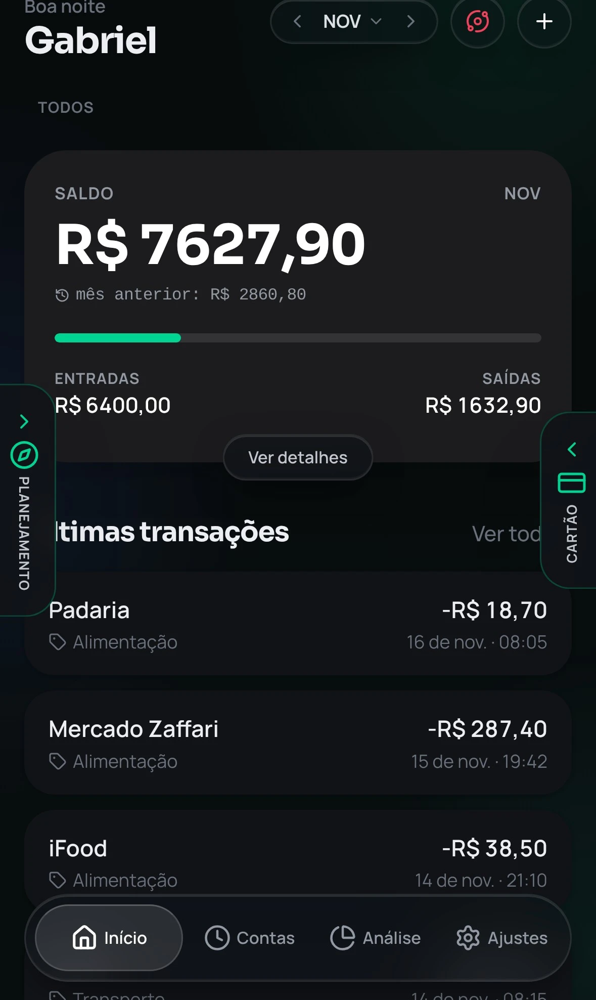
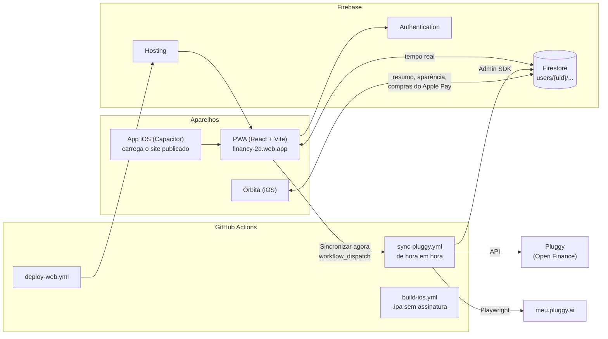

<div align="center">

# Financy

**App de finanças pessoais para web e iPhone, com as transações do Nubank e do Mercado Pago entrando sozinhas via Open Finance.**

[](https://github.com/GabrielPMachado/Financy/actions/workflows/ci.yml)
[](https://github.com/GabrielPMachado/Financy/actions/workflows/deploy-web.yml)
[](https://github.com/GabrielPMachado/Financy/actions/workflows/build-ios.yml)


[**Abrir o app**](https://financy-2d.web.app) · [Arquitetura](#arquitetura) · [Como rodar](#como-rodar) · [English](#english)

</div>

<p align="center">
  
  <br />
  <sub>O Financy de verdade numa tela de iPhone: início, análise do mês, contas e o lançamento rápido. Gravado do app real no navegador, com dados fictícios no lugar da conta real.</sub>
</p>

## Sumário

- [Sobre](#sobre)
- [Recursos](#recursos)
- [Arquitetura](#arquitetura)
- [Stack](#stack)
- [Estrutura de pastas](#estrutura-de-pastas)
- [Como rodar](#como-rodar)
- [Qualidade e CI](#qualidade-e-ci)
- [Deploy](#deploy)
- [Decisões técnicas](#decisões-técnicas)
- [Guias](#guias)
- [Segurança](#segurança)
- [Licença](#licença)
- [English](#english)

## Sobre

O Financy organiza receitas, despesas, cartões e investimentos num só lugar. A diferença para uma planilha é que os lançamentos dos bancos **chegam sozinhos**: um robô no GitHub Actions busca as transações via Open Finance (Pluggy) de hora em hora e grava no Firestore do usuário. O app tem login, sincroniza em tempo real entre aparelhos e funciona offline.

Roda como PWA no navegador e como app nativo no iPhone (Capacitor), que carrega o site publicado e por isso nunca fica desatualizado.

## Recursos

- Receitas, despesas e investimentos, com parcelamento e recorrência
- Cartões de crédito com limite usado e pagamento de fatura
- Categorias personalizadas, histórico com filtros e exportação (JSON/CSV)
- Análise mensal por categoria e comparação com o mês anterior
- Calculadora freelancer, pendências a receber e área de planejamento (dívidas e metas)
- Tema claro, escuro ou automático, com cores e ícones compartilhados com o [Órbita](https://github.com/GabrielPMachado/Orbita)
- Sincronização em tempo real entre dispositivos (Firebase) e funcionamento offline
- Importação automática dos bancos de hora em hora (GitHub Actions + Meu Pluggy)
- Atalhos do iPhone: "tocar nas costas" registra um freela ou mostra o resumo

## Arquitetura

O projeto não tem servidor próprio. O front-end fala direto com o Firebase, e o trabalho pesado (buscar extratos, logar no Meu Pluggy) roda em workflows agendados do GitHub Actions.



**Fluxo de uma transação bancária**

1. O workflow `sync-pluggy.yml` abre o Meu Pluggy com Playwright e pede a atualização dos bancos (a API não permite isso para itens do Meu Pluggy).
2. `scripts/sync-pluggy.mjs` lê as transações na API da Pluggy e converte cada uma num lançamento com id fixo (`pluggy-<id>`).
3. O lançamento é gravado em `users/{uid}` com o Admin SDK, sem sobrescrever o que já foi editado no app.
4. O app recebe a mudança em tempo real pelo `onSnapshot` do Firestore.

## Stack

| Camada | Tecnologias |
| --- | --- |
| Interface | React 19, TypeScript, Tailwind CSS 4, Motion, Recharts, Lucide |
| Build | Vite 6 (chunks separados para Firebase e gráficos) |
| Dados e login | Firebase Authentication (e-mail/senha e Google) + Cloud Firestore |
| iPhone | PWA com service worker + Capacitor 8 (app nativo) |
| Open Finance | Pluggy / Meu Pluggy, Playwright, IMAP (login automático) |
| Automação | GitHub Actions (sync de hora em hora, deploy, build do .ipa, CI) |

## Estrutura de pastas

```
.
├── .github/workflows/
│   ├── ci.yml              # checagem de tipos + build em todo push e PR
│   ├── deploy-web.yml      # publica no Firebase Hosting
│   ├── build-ios.yml       # gera o .ipa (macOS) para o Sideloadly
│   └── sync-pluggy.yml     # sincronização bancária de hora em hora
├── docs/                   # guia dos Atalhos do iPhone e a animação do README
├── public/                 # manifest, ícones e service worker do PWA
├── resources/app-icons/    # ícones do app nativo (principal e alternativos)
├── scripts/
│   ├── sync-pluggy.mjs        # Pluggy → Firestore
│   ├── meupluggy-refresh.mjs  # robô do Meu Pluggy (Playwright + IMAP)
│   ├── notify-ntfy.mjs        # push com o resultado do sync
│   └── revoke-shortcut-key.mjs
├── src/
│   ├── App.tsx             # estado da aplicação e navegação entre telas
│   ├── components/         # telas e componentes por domínio
│   │   ├── auth/  cards/  categories/  common/  dashboard/
│   │   └── layout/  planning/  settings/  simulations/  transactions/
│   └── lib/                # regras de negócio e integrações
│       ├── firebase.ts       # Auth + Firestore
│       ├── transactions.ts   # parcelas, recorrência, faturas
│       ├── githubSync.ts     # botão "Sincronizar agora"
│       ├── syncErrors.ts     # mensagens de erro do sync
│       ├── orbitaBridge.ts   # integração com o Órbita
│       └── appearance.ts     # cores e ícones compartilhados
├── firestore.rules         # cada usuário só acessa users/{uid}
├── capacitor.config.ts
└── vite.config.ts
```

## Como rodar

### Pré-requisitos

- Node.js 22+
- Um projeto Firebase (Authentication + Firestore) com a configuração em `firebase-applet-config.json`
- Opcional: conta na [Pluggy](https://pluggy.ai) para a sincronização bancária

### Instalação

```bash
git clone https://github.com/GabrielPMachado/Financy.git
cd Financy
npm install
cp .env.example .env.local   # preencha só o que for usar
npm run dev                  # http://localhost:3000
```

### Variáveis de ambiente

Todas estão documentadas em [`.env.example`](.env.example). Nenhuma é obrigatória para abrir o app.

| Variável | Para que serve |
| --- | --- |
| `PLUGGY_CLIENT_ID`, `PLUGGY_CLIENT_SECRET`, `PLUGGY_ITEM_IDS` | Sincronização bancária |
| `FIREBASE_SERVICE_ACCOUNT`, `SYNC_USER_EMAIL` | Onde o sync grava os lançamentos |
| `VITE_GITHUB_SYNC_TOKEN` | Botão "Sincronizar agora" (prefira colar o token nos Ajustes) |
| `MEUPLUGGY_EMAIL`, `GMAIL_APP_PASSWORD` | Login automático do robô no Meu Pluggy |

### Scripts

| Comando | O que faz |
| --- | --- |
| `npm run dev` | Servidor de desenvolvimento na porta 3000 |
| `npm run lint` | Checagem de tipos (`tsc --noEmit`) |
| `npm run build` | Build de produção em `dist/` |
| `npm run preview` | Serve o build localmente |
| `npm run sync:pluggy:dry` | Testa a leitura da Pluggy sem gravar nada |
| `npm run sync:pluggy` | Sincroniza os bancos com o Firestore |
| `npm run meupluggy:refresh` | Pede a atualização dos bancos no Meu Pluggy |

## Qualidade e CI

| Workflow | Quando roda | O que faz |
| --- | --- | --- |
| [`ci.yml`](.github/workflows/ci.yml) | Todo push na `main` e todo pull request | `npm ci`, checagem de tipos e build de produção |
| [`deploy-web.yml`](.github/workflows/deploy-web.yml) | Push na `main` que muda o app | Publica no Firebase Hosting |
| [`build-ios.yml`](.github/workflows/build-ios.yml) | Mudança na parte nativa | Compila o .ipa num Mac do GitHub |
| [`sync-pluggy.yml`](.github/workflows/sync-pluggy.yml) | De hora em hora e sob demanda | Sincronização bancária |

## Deploy

- **Web (PWA):** automático a cada push na `main`, pelo `deploy-web.yml`, em **https://financy-2d.web.app**. No iPhone: Safari → Compartilhar → *Adicionar à Tela de Início*.
- **iPhone (nativo):** rode **Build iOS** na aba Actions, baixe o artefato **Financy-ipa** e instale com o Sideloadly.
- **Regras do Firestore:** `firebase deploy --only firestore:rules`.

## Decisões técnicas

- **Sem back-end próprio.** Firebase cuida de login, dados e hospedagem, e o GitHub Actions faz o papel de "servidor agendado". Custo zero e nada para manter no ar.
- **App nativo que carrega o site publicado.** O Capacitor aponta para `financy-2d.web.app` (`CAP_REMOTE=1`), então qualquer mudança no código web chega ao iPhone sem reinstalar o .ipa. Só plugins, ícones e esquemas de link pedem um build novo.
- **Ids determinísticos no sync.** Cada transação vira `pluggy-<id>`: rodar o sync várias vezes nunca duplica nem sobrescreve uma edição feita no app.
- **Robô em vez de API para o Meu Pluggy.** A API da Pluggy não atualiza itens do Meu Pluggy, então o workflow usa Playwright, guarda a sessão no cache do Actions e refaz o login pelo link que chega no Gmail (IMAP).
- **Erros com código.** Cada etapa do workflow falha com um código (`Falha [codigo]`) que o app traduz em uma mensagem clara (`src/lib/syncErrors.ts`).
- **Integração com o Órbita pelo Firestore.** Os dois apps compartilham resumo, aparência e compras do Apple Pay por documentos em `users/{uid}`, sem uma API entre eles.
- **Chunks manuais no Vite.** Firebase e Recharts ficam em arquivos separados, o que deixa o primeiro carregamento mais leve e melhora o cache entre versões.

## Guias

<details>
<summary><b>Sincronização bancária (Open Finance)</b></summary>

O script `scripts/sync-pluggy.mjs` busca as transações a partir de 01/10/2026 (`SYNC_FROM`, configurável) na API da [Pluggy](https://pluggy.ai) e grava no Firestore do usuário:

- contas correntes viram receitas e despesas;
- compras no cartão viram despesas vinculadas ao cartão (que é criado automaticamente);
- pagamentos de fatura feitos pela conta reduzem o limite usado do cartão;
- cada lançamento tem um id fixo (`pluggy-<id>`), então rodar várias vezes **não duplica** e **não sobrescreve** edições feitas no app.

> Transferências entre as suas próprias contas aparecem como saída em uma e entrada na outra.

#### Configuração única

1. Crie contas em [meu.pluggy.ai](https://meu.pluggy.ai) (conectar os bancos) e em [dashboard.pluggy.ai](https://dashboard.pluggy.ai) (credenciais da aplicação), e vincule o conector **MeuPluggy** à aplicação.
2. Preencha as variáveis do `.env.example` no seu `.env.local`.
3. Teste a leitura, sem gravar nada: `npm run sync:pluggy:dry`
4. Grave de verdade: `npm run sync:pluggy`

#### Automático (GitHub Actions)

O workflow `.github/workflows/sync-pluggy.yml` roda de hora em hora (minuto 7) e pode ser disparado manualmente em **Actions → Sincronizar bancos → Run workflow**. Cadastre em **Settings → Secrets and variables → Actions**:

| Secret | Conteúdo |
|---|---|
| `PLUGGY_CLIENT_ID` | Client ID da aplicação Pluggy |
| `PLUGGY_CLIENT_SECRET` | Client Secret da aplicação Pluggy |
| `PLUGGY_ITEM_IDS` | IDs dos itens separados por vírgula |
| `FIREBASE_SERVICE_ACCOUNT` | JSON completo da conta de serviço do Firebase |
| `SYNC_USER_EMAIL` | E-mail da conta do Financy que recebe os dados |
| `MEUPLUGGY_EMAIL` | E-mail da conta do Meu Pluggy (um Gmail), para o robô entrar sozinho |
| `GMAIL_APP_PASSWORD` | [Senha de app](https://myaccount.google.com/apppasswords) desse Gmail: o robô pede o e-mail de acesso do Meu Pluggy e lê o código/link |
| `MEUPLUGGY_PASSWORD` | Opcional: em vez da senha de app, para contas com senha |
| `NTFY_TOPIC` | Opcional: tópico do app [ntfy](https://ntfy.sh) que recebe um push ao fim de cada sync manual (banco atualizado e quantos lançamentos entraram, ou o motivo da falha; nunca valores). Use um nome difícil de adivinhar |

#### Atualização automática no Meu Pluggy

A API da Pluggy não deixa atualizar itens do MeuPluggy, então o workflow abre o site (Playwright, em nuvem) e clica em **Atualizar** antes de sincronizar: Mercado Pago e Nubank, de hora em hora.

O robô guarda a sessão do Meu Pluggy no **cache do Actions** e a renova a cada execução. Quando ela expira (o Meu Pluggy desloga a cada ~1 dia e meio), ele **entra sozinho**: pede o e-mail de acesso do Meu Pluggy e abre o link que chega no Gmail (lido por IMAP com a senha de app em `GMAIL_APP_PASSWORD`). Não precisa do PC.

Se o clique falhar, a sincronização segue com os dados que a Pluggy já tem.

#### Velocidade e horário

- **No app** (Ajustes > Bancos): *Buscar agora* (~30 s, sem pedir atualização ao Meu Pluggy), *Atualizar Mercado Pago*, *Atualizar Nubank* ou os dois. O botão de atualizar do topo atualiza os dois bancos.
- **Pelo iPhone:** o Atalho dispara o workflow pela API do GitHub; com o secret `NTFY_TOPIC`, o resultado chega como push no app ntfy.

#### Mensagens de erro

O app mostra uma mensagem diferente para cada causa (token inválido, sem permissão, workflow desatualizado, sem internet, sessão do Meu Pluggy expirada, Meu Pluggy fora do ar, Pluggy recusou o Client ID/Secret, falha ao gravar no Firestore…). Elas vêm das etapas `Falha [codigo]` do workflow, traduzidas em `src/lib/syncErrors.ts`.

</details>

<details>
<summary><b>iPhone: PWA, sem App Store</b></summary>

O workflow `.github/workflows/deploy-web.yml` publica o app em **https://financy-2d.web.app** (Firebase Hosting) a cada push na `main` que muda o app, ou manualmente em **Actions → Publicar site → Run workflow**. Usa o mesmo secret `FIREBASE_SERVICE_ACCOUNT`; se der erro de permissão, dê à conta de serviço o papel **Administrador do Firebase Hosting** (Google Cloud → IAM).

No iPhone: abra o endereço no **Safari** → Compartilhar → **Adicionar à Tela de Início**. Abre em tela cheia, com ícone, e se atualiza sozinho a cada publicação.

- Login com Google no app instalado: adicione `https://financy-2d.web.app/__/auth/handler` em *URIs de redirecionamento autorizados* do cliente OAuth "Web client (auto created by Google Service)" (Google Cloud → APIs e serviços → Credenciais). E-mail e senha funcionam sem isso.
- O site é público, então o build não embute o token do GitHub: cole-o em Ajustes > Bancos para usar *Sincronizar agora*.

</details>

<details>
<summary><b>iPhone: app nativo com o Sideloadly</b></summary>

Além do PWA, o Financy tem um app nativo para iPhone (Capacitor), instalado pelo **Sideloadly** no Windows:

1. Na aba **Actions**, rode **Build iOS (.ipa para Sideloadly)** (roda sozinho quando muda a parte nativa).
2. Baixe o artefato **Financy-ipa**, extraia o `Financy.ipa` e instale pelo Sideloadly com seu Apple ID.

O app carrega o site publicado (`https://financy-2d.web.app`), então toda mudança no código web chega sozinha, sem reinstalar. Só a parte nativa (plugins, ícone, links) pede um .ipa novo. Com Apple ID gratuito o app vale 7 dias (reinstale; os dados ficam na nuvem).

</details>

<details>
<summary><b>iPhone: "Tocar nas costas" e a ilha de resumo</b></summary>

O Financy funciona no iPhone como PWA (sem Mac e sem App Store), com uma "ilha" de resumo no estilo da Dynamic Island que abre com o gesto de tocar nas costas do aparelho.

1. **Publicar:** é automático. O workflow `deploy-web.yml` publica em `https://financy-2d.web.app` a cada push na `main` que muda o app.
2. **Instalar**: no Safari do iPhone, abra o endereço, entre na conta e use Compartilhar › *Adicionar à Tela de Início*.
3. **Atalhos com o gesto de tocar nas costas** (sem abrir o Safari): 2 toques registram um trabalho freelancer e 3 toques mostram o resumo, ambos em caixas nativas do iOS. Passo a passo em [docs/ATALHOS-IPHONE.md](docs/ATALHOS-IPHONE.md).
   - *Alternativa que abre o app:* um Atalho com **Abrir URLs** em `https://financy-2d.web.app/?action=resumo` (ilha de resumo) ou `?action=quick-add` (lançamento rápido).

Limites do iOS: a ação **Abrir URLs** abre no Safari, não no app da Tela de Início, e os dois guardam o login separadamente (entre uma vez nos dois). Os Atalhos da pasta `docs` não dependem desse login: usam a chave de *Ajustes › Atalho do iPhone*. A Dynamic Island de verdade (Live Activity) exige app nativo, Mac e Xcode.

</details>

<details>
<summary><b>Integração com o Órbita</b></summary>

- **Links:** `financy://resumo` abre o resumo; `financy://novo?tipo=expense&valor=12.50&descricao=Padaria&categoria=Alimentação&data=2026-11-14` abre o lançamento já preenchido (no site, os mesmos parâmetros funcionam com `?action=quick-add`). O botão de órbita no topo abre o Órbita (`orbita://`).
- **Chave:** *Ajustes › Órbita › Copiar chave* e cole no Órbita (*Configurações › Financy*). O Órbita passa a mostrar o saldo do Financy (lido de `users/{uid}/resumo/atual`).
- **Aparência compartilhada:** *Ajustes › Cor do app* tem as mesmas cores do Órbita (e as suas), a roda de intensidade (toque numa cor) e o estilo/cor dos ícones. Fica em `users/{uid}/aparencia/compartilhada`; quem mudou por último, aqui ou no Órbita, vale para os dois (dá para desligar em *Ajustes › Órbita*). Código em `src/lib/appearance.ts`.
- **Compras do Apple Pay:** o Órbita grava cada compra com a categoria escolhida na hora em `users/{uid}/comprasApplePay`. Quando a mesma compra chega pelo Open Finance (mesmo valor, até 2 dias depois, horário mais próximo), o Financy aplica a categoria nela e apaga o aviso. Não cria lançamento, então nada é contado em dobro. Avisos sem par em 10 dias são descartados. Código em `src/lib/orbitaBridge.ts`.

</details>

## Segurança

- As regras do Firestore (`firestore.rules`) só permitem que cada usuário autenticado leia e escreva os próprios dados em `users/{uid}`. Publique-as com `firebase deploy --only firestore:rules` ou pelo console.
- Os segredos ficam só nos Secrets do GitHub, e o script de sync nunca imprime valores nem descrições de transações no log, apenas contagens.
- O site é público, então o build não embute o token do GitHub.

## Licença

Projeto pessoal de [Gabriel Pinto Machado](https://github.com/GabrielPMachado). Uso pessoal; todos os direitos reservados.

---

## English

<details open>
<summary><b>Financy: personal finance app for web and iPhone</b></summary>

### About

Financy keeps income, expenses, credit cards and investments in one place. Bank transactions from **Nubank** and **Mercado Pago** arrive on their own: a scheduled GitHub Actions job pulls them through Open Finance (Pluggy) every hour and writes them to the user's Firestore. It has sign-in, real-time sync across devices and works offline. It runs as a PWA and as a native iPhone app (Capacitor) that loads the published site, so it is always up to date.

### Features

- Income, expenses and investments with installments and recurrence
- Credit cards with used limit and bill payments
- Custom categories, filtered history and JSON/CSV export
- Monthly analysis by category, compared with the previous month
- Freelance calculator, receivables and a planning area (optional AI assistant)
- Light, dark or automatic theme, shared with [Órbita](https://github.com/GabrielPMachado/Orbita)
- Hourly automatic bank import (GitHub Actions + Meu Pluggy)

### Architecture

There is no custom back end. The React front end talks to Firebase (Auth + Firestore + Hosting) directly, and GitHub Actions acts as a scheduled server: it asks Meu Pluggy to refresh the banks (Playwright), reads the transactions from the Pluggy API and writes them with the Admin SDK using deterministic ids (`pluggy-<id>`), so repeated runs never duplicate or overwrite edits. See the [diagram above](#arquitetura).

### Getting started

```bash
git clone https://github.com/GabrielPMachado/Financy.git
cd Financy
npm install
cp .env.example .env.local   # fill in only what you need
npm run dev                  # http://localhost:3000
```

| Script | Description |
| --- | --- |
| `npm run dev` | Dev server on port 3000 |
| `npm run lint` | Type check (`tsc --noEmit`) |
| `npm run build` | Production build |
| `npm run sync:pluggy:dry` | Read from Pluggy without writing |
| `npm run sync:pluggy` | Sync banks into Firestore |

### CI and deploy

`ci.yml` type-checks and builds on every push and pull request. `deploy-web.yml` publishes to Firebase Hosting (https://financy-2d.web.app), `build-ios.yml` builds an unsigned .ipa on a GitHub macOS runner for Sideloadly, and `sync-pluggy.yml` runs the hourly bank sync.

### Key decisions

- **Serverless by design:** Firebase plus scheduled GitHub Actions, zero hosting cost.
- **Native shell loading the live site:** web changes reach the iPhone without reinstalling.
- **Idempotent sync:** deterministic ids, safe to run any number of times.
- **Per-user Firestore rules:** each user can only read and write `users/{uid}`.

### License

Personal project by [Gabriel Pinto Machado](https://github.com/GabrielPMachado). All rights reserved.

</details>
